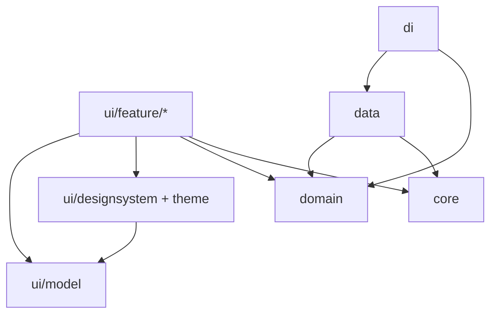

# Lista de Tarefas

Aplicativo Android nativo para organizar tarefas do dia a dia. Totalmente
**offline**, em português (pt-BR), construído com **Kotlin + Jetpack Compose
(Material 3)** e arquitetura **MVI**.

O app concentra tudo em uma única lista: tarefas com título e descrição, abas
Ativas/Concluídas, etiquetas coloridas, data limite com indicador de
proximidade, busca por texto e seis formas de ordenação com preferência
persistida.

## Funcionalidades

| Área | O que faz |
|:--|:--|
| Tarefas | Criar, editar e excluir com confirmação; título (até 120 caracteres) e descrição (até 2000) com contadores e validação inline; persistência local em Room |
| Conclusão | Checkbox para concluir/reabrir; abas **Ativas** e **Concluídas**; título riscado e “Concluída em dd/MM/aaaa”; a aba selecionada é persistida |
| Etiquetas | Nome único (até 30 caracteres, ignorando caixa/acentos) e cor de uma paleta fixa de 8 opções; chip acessível na linha, sem cor como único sinal; uma etiqueta por tarefa |
| Prazos | Data limite opcional (somente data, pt-BR) e indicador textual + ícone: **Atrasada**, **Hoje**, **Amanhã** ou **Até 7 dias**; recalculado ao abrir, no resume e em mudanças de data/hora/fuso (sem timer de meia-noite) |
| Busca | Substring no título ou na descrição, ignorando caixa e acentos, escopada à aba visível e preservada ao voltar do formulário |
| Ordenação | Título A-Z/Z-A, criação recente/antiga, prazo próximo/distante; padrão “criação mais recente”; a opção atual fica visível e persiste entre sessões |
| Acessibilidade | TalkBack com textos integrais, alvos de toque de pelo menos 48dp, suporte a fonte 200% e todas as strings em recursos (`pt-BR`) |

## Stack

| Item | Versão / escolha |
|:--|:--|
| Linguagem | Kotlin 2.2.10 (JVM target 11) |
| UI | Jetpack Compose + Material 3 (Compose BOM 2026.02.01) |
| Navegação | Navigation Compose com rotas type-safe (`kotlinx.serialization`) |
| Injeção de dependência | Hilt 2.60.1 com KSP |
| Persistência | Room 2.7.2 (schemas exportados em `app/schemas/`) e DataStore Preferences 1.1.7 |
| Concorrência | Kotlin Coroutines/Flow 1.10.2 |
| Testes | JUnit4, `kotlinx-coroutines-test` e Turbine; Compose UI Test no `androidTest` |
| Build | AGP 9.5.0, Gradle 9.6.0 (wrapper), R8 no release |
| SDK | `minSdk` 30 · `targetSdk`/`compileSdk` 37 |

## Arquitetura

Módulo Gradle único (`:app`) com separação por camadas em pacotes:

```
app/src/main/java/com/foli/listadetarefas/
├── core/        # result/failure, texto, tempo, formatação, paleta, analytics, logging
├── domain/      # modelos, regras puras (validação, filtro, ordenação, prazo) e use cases
├── data/        # Room, DataStore, mappers e implementações de repositório
├── di/          # módulos Hilt (database, datastore, repositórios, dispatchers, tempo)
└── ui/          # tema, design system, ui/model compartilhado, navegação e features
    ├── feature/tasks/     # S1 lista, S2 formulário, S5 ordenação, S6 exclusão
    ├── feature/labels/    # S3 etiquetas, S4 criar/editar, S7 seletor
    ├── designsystem/      # componentes reutilizáveis (TaskRow, chips, sheets, busca...)
    └── model/             # TaskUiModel, DeadlineUiState, LabelUiModel...
```

Direção das dependências:



Princípios aplicados:

- **Unidirectional Data Flow (MVI)** — `State` imutável, `Action` da UI e
  `Effect` one-shot; ViewModel único por tela.
- **Domínio puro** — regras de negócio sem Android (`AppResult`/`AppFailure`),
  testáveis com JUnit.
- **Fronteiras verificadas por teste** — `ArchitectureRulesTest` falha o build
  se uma camada importar algo proibido (ex.: `domain` importando Android).
- **Offline por construção** — sem rede, sem telemetria remota (tracker no-op),
  sem permissões e com `allowBackup=false`.

### Persistência e tempo

- **Room**: tarefas e etiquetas, com migração versionada (v1 → v2 ao introduzir
  etiquetas) e índices de unicidade de nome.
- **DataStore Preferences**: aba selecionada e ordenação vigente.
- **Datas e prazos**: `TimeProvider` + `TimeSignals` alimentados pelo ciclo de
  vida e por broadcasts de mudança de data/hora/fuso, garantindo recálculo sem
  timers em segundo plano.

## Como rodar

Pré-requisitos:

- Android Studio (com JDK 17+ embutido; o projeto usa Gradle 9.6 e AGP 9.5)
- Android SDK Platform 37 e um emulador ou dispositivo com Android 11+ (API 30)

```powershell
git clone https://github.com/WTFilipe/ListaDeTarefas.git
cd ListaDeTarefas

# Abra no Android Studio (recomendado) ou crie o local.properties apontando para o SDK:
# sdk.dir=C:\\Users\\<voce>\\AppData\\Local\\Android\\Sdk

.\gradlew.bat assembleDebug
.\gradlew.bat installDebug
```

O APK de debug é gerado em `app/build/outputs/apk/debug/`.

## Testes e qualidade

```powershell
# Testes unitários JVM (inclui o gate de arquitetura)
.\gradlew.bat testDebugUnitTest

# Build completo: debug + release com R8 + testes + lint
.\gradlew.bat build

# Testes instrumentados (requer emulador/dispositivo conectado)
.\gradlew.bat connectedDebugAndroidTest
```

- Mais de **200 testes unitários** cobrindo domínio (validação, busca,
  ordenação, prazos), mappers, DataStore real e ViewModels (coroutines + Turbine).
- `ArchitectureRulesTest` valida as regras de dependência entre camadas e a
  presença das strings localizadas.
- Testes instrumentados de acessibilidade verificam semântica de TalkBack e
  alvos de toque; o release aplica R8 (`optimization.enable`).

## Estrutura do repositório

| Caminho | Conteúdo |
|:--|:--|
| `app/` | Código-fonte do aplicativo (`src/main`), testes (`src/test`, `src/androidTest`) e schemas do Room |
| `gradle/libs.versions.toml` | Catálogo de versões e dependências |
| `.squad/` | Documentação do processo: pedido, PRD, design spec, arquitetura, ADRs, planos e revisões |
| `settings.gradle.kts` | Configuração do projeto e repositórios |

As decisões arquiteturais estão registradas em
`.squad/artifacts/architecture/adr/` (ADR-0001 a ADR-0012), incluindo módulo
único por camadas, MVI, Hilt com KSP, Room + DataStore, normalização pt-BR e
design system local.

## Status e histórico de branches

O desenvolvimento foi conduzido em histórias (`US-01` a `US-07`) em branches
`squad/*`, com MRs empilhados (um por tarefa + um de integração por história).
Todo o trabalho está consolidado em `master`:

| História | Escopo | Situação |
|:--|:--|:--|
| US-01 | CRUD de tarefas com persistência | Integrada em `master` (PR #1) |
| US-02 | Limites e contadores de texto | Integrada em `master` (PR #2) |
| US-03 | Conclusão e aba Concluídas | Integrada em `master` |
| US-04 | Etiquetas com paleta fixa | Integrada em `master` |
| US-05 | Data limite e indicador de prazo | Integrada em `master` |
| US-06 | Busca por título e descrição | Integrada em `master` |
| US-07 | Ordenação da lista | Integrada em `master` |

As branches `squad/*` e os MRs (#4 a #12) ficam como registro do processo; a
`master` é a fonte de verdade do código e do README.

## Privacidade

Todos os dados ficam no dispositivo. O app não declara permissões, não faz
requisições de rede, não envia telemetria e desativa backup automático. Textos
do usuário nunca são escritos em logs ou eventos de analytics.

## Documentação do processo

Este repositório também registra o processo de desenvolvimento assistido por uma
squad de agentes em `.squad/`:

- `artifacts/product/` — requisição, PRD e backlog (`STORIES.json`);
- `artifacts/design/` — color scheme, design spec MD3 e preview;
- `artifacts/architecture/` — perfil técnico, arquitetura e ADRs;
- `artifacts/traceability/` — matriz de rastreabilidade história × entrega;
- `stories/US-XX/` — planos, implementações, revisões e MRs por história.
